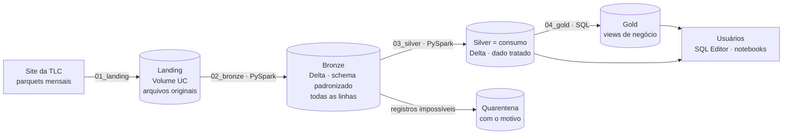

# Case Técnico Data Architect — iFood · NYC Taxi Trips

Ingestão das corridas de táxi de Nova York (TLC) de **janeiro a maio de 2023** em um Data Lake no Databricks, com camada de consumo em SQL e respostas às perguntas do case.

## Respostas

### Pergunta 1 — Média de `total_amount` recebido em um mês (yellow taxis)

| Mês | Corridas | Média por corrida | Receita do mês |
|---|---:|---:|---:|
| 2023-01 | 3.066.715 | US$ 27,02 | US$ 82.863.321,14 |
| 2023-02 | 2.913.624 | US$ 26,90 | US$ 78.368.971,28 |
| 2023-03 | 3.403.220 | US$ 27,80 | US$ 94.618.312,45 |
| 2023-04 | 3.288.064 | US$ 28,27 | US$ 92.950.852,07 |
| 2023-05 | 3.513.531 | US$ 28,96 | US$ 101.761.507,99 |

- **Média por corrida no período: ~US$ 27,84**, subindo mês a mês desde fevereiro.
- **Receita média mensal da frota yellow: ~US$ 90,1 milhões.**
- A mediana fica em torno de US$ 20–21: a distribuição tem cauda longa (corridas caras, como as de aeroporto, puxam a média para cima).

### Pergunta 2 — Média de passageiros por hora do dia, maio/2023 (todos os táxis)

| Hora | Média | Hora | Média | Hora | Média |
|---:|---:|---:|---:|---:|---:|
| 0h | 1,43 | 8h | 1,29 | 16h | 1,40 |
| 1h | 1,43 | 9h | 1,31 | 17h | 1,39 |
| 2h | **1,45** | 10h | 1,35 | 18h | 1,38 |
| 3h | **1,45** | 11h | 1,36 | 19h | 1,39 |
| 4h | 1,40 | 12h | 1,37 | 20h | 1,40 |
| 5h | 1,28 | 13h | 1,38 | 21h | 1,42 |
| 6h | **1,26** | 14h | 1,39 | 22h | 1,43 |
| 7h | 1,28 | 15h | 1,40 | 23h | 1,42 |

A média fica perto de **1,4 passageiro** ao longo do dia, com um padrão claro:

- **Madrugada (0h–3h): a maior média, 1,43–1,45**, com pico às 2h–3h
- **Início da manhã (5h–8h): a menor média, 1,26–1,29**, com mínimo às 6h
- **Ao longo do dia a média sobe gradualmente** (1,31 às 9h → 1,40 às 15h) e volta a 1,42–1,43 à noite (21h–23h).

Gráfico em [`analysis/02_respostas`](analysis/02_respostas).

### Premissas

- **P1:** estornos e disputas (`total_amount < 0`, ~141 mil linhas, ~0,9%) foram **mantidos**. Eles anulam cobranças já feitas, então a soma do mês reflete a receita líquida.
- **P2:** "todos os táxis da frota" = **yellow + green**, os táxis na classificação da TLC. For-Hire Vehicles e High Volume FHV (Uber/Lyft) não são táxis e não possuem `passenger_count`. O green representa ~2% das corridas.
- **P2:** hora = hora local de Nova York do **embarque**. Corridas com `passenger_count` nulo ou 0 ficam fora da média (0 passageiro numa corrida paga é erro de digitação; nulo é ausência de informação).

## Arquitetura



| Camada | Objeto no Unity Catalog | Conteúdo |
|---|---|---|
| Landing | Volume `workspace.nyc_taxi_landing.raw_files` | Parquets originais, sem alteração, em `<tipo>/<ano>/<mês>/` |
| Bronze | `workspace.nyc_taxi_bronze.{yellow,green}_tripdata` | Todas as linhas e colunas, tipos padronizados, + `ref_month`, `source_file`, `ingestion_ts` |
| Silver (consumo) | `workspace.nyc_taxi_silver.{yellow,green}_tripdata` | Linhas válidas, colunas do case + colunas úteis e flags de qualidade |
| Quarentena | `workspace.nyc_taxi_silver.{yellow,green}_tripdata_quarantine` | Linhas rejeitadas, com `reject_reason` |
| Gold | `workspace.nyc_taxi_gold.vw_fleet_trips` | Frota unificada (yellow + green) com nomes de colunas padronizados |
| Gold | `workspace.nyc_taxi_gold.vw_yellow_monthly_revenue` | Resumo financeiro mensal do yellow |

A silver de yellow contém as colunas exigidas — `VendorID`, `passenger_count`, `total_amount`, `tpep_pickup_datetime`, `tpep_dropoff_datetime` — mais `trip_distance`, `PULocationID`, `DOLocationID`, `payment_type`, `trip_duration_min`, `is_valid_passenger_count`, `is_negative_amount` e `ref_month`.

## Decisões técnicas

**Databricks Free Edition + Unity Catalog.** O Community Edition recomendado no enunciado foi descontinuado em 01/01/2026; o Free Edition é o substituto oficial. O Unity Catalog é a tecnologia de metadados: schemas, volume, tabelas e colunas são criados explicitamente com `COMMENT`, então o próprio catálogo documenta os dados para quem consome.

**Camadas (landing → bronze → silver → gold).** A landing guarda o arquivo original para reprocessar sem depender do site da TLC. A bronze mantém tudo, inclusive linhas ruins: quando uma regra de qualidade muda, só a silver é reprocessada (foi o que aconteceu durante o desenvolvimento ao decidir manter os estornos).

**Lógica em módulos Python, notebooks só para orquestrar.** As funções ficam em `src/nyc_taxi/` (importáveis, reutilizáveis e testáveis fora do Databricks). Os notebooks em `src/jobs/` apenas chamam essas funções na ordem certa.

**PySpark para transformar, SQL para estruturar e consumir.** Leitura, padronização e validação são feitas com DataFrames PySpark. DDL (schemas, volume, tabelas, views) e as respostas são em SQL: é a linguagem padrão para definição de estrutura e a que o usuário final usa.

**Schema fixo na bronze.** Cada parquet é lido individualmente e projetado com `cast` para um schema definido em `src/nyc_taxi/schemas.py`. Os nomes de coluna são resolvidos sem diferenciar maiúsculas (a taxa de aeroporto aparece como `airport_fee` e `Airport_fee` nos arquivos da TLC) e uma coluna ausente vira nulo tipado em vez de quebrar a carga.

**Idempotência.** A landing pula arquivos já baixados e grava via arquivo temporário (um download interrompido não deixa parquet corrompido). Bronze e silver usam escrita Delta com `replaceWhere` na partição `ref_month`: reprocessar um mês substitui só aquele mês, sem duplicar.

**Qualidade: quarentena em vez de descarte silencioso.**

| Regra | Vai para a quarentena quando | Linhas (yellow, jan–mai) |
|---|---|---:|
| `pickup_outside_reference_month` | Embarque nulo ou fora do mês do arquivo | ver `by_reason` no `03_silver` |
| `dropoff_before_pickup` | Desembarque nulo ou anterior ao embarque | ver `by_reason` no `03_silver` |
| `null_total_amount` | `total_amount` nulo | — |

Ficam na silver, sinalizados por flags, os casos que não invalidam a corrida:
- `is_negative_amount`: estornos e disputas (`payment_type` 4 = disputa ~59%, 2 = dinheiro ~23%, 3 = sem cobrança ~18%). O valor médio dos negativos (~US$ −25) espelha o de uma corrida típica, o que indica estorno de corridas reais.
- `is_valid_passenger_count`: `false` quando o passageiro é nulo ou 0.

**Integridade verificada:** bronze = silver + quarentena, mês a mês.

| | Bronze | Silver | Quarentena |
|---|---:|---:|---:|
| yellow | 16.186.386 | 16.185.154 | 1.232 |
| green | 339.630 | 339.582 | 48 |

**Fuso horário.** Os timestamps da TLC são hora local de NY sem fuso. A sessão do pipeline roda em UTC (o Spark não desloca as horas na leitura) e a silver grava `TIMESTAMP_NTZ`, então `HOUR(pickup_datetime)` devolve a hora local correta para qualquer consumidor, independentemente do fuso da sessão dele.

**Gold como views.** Volume pequeno e consultas rápidas: views ficam sempre atualizadas com a silver, sem outro job. A `vw_fleet_trips` esconde a diferença de nomes entre yellow (`tpep_*`) e green (`lpep_*`).

**Orquestração com Lakeflow Jobs.** O Job `ifood_case_nyc_taxi` executa `setup → landing → bronze → silver → gold` em sequência, em computação serverless (execução completa em ~3,5 minutos). A definição do Job está versionada em [`resources/ifood_case_job.yml`](resources/ifood_case_job.yml).

## Estrutura do repositório

```
ifood-case/
├─ src/
│  ├─ nyc_taxi/                 # lógica do pipeline (módulos Python)
│  │  ├─ config.py              # catálogo, schemas, meses e tipos de táxi
│  │  ├─ schemas.py             # schema padrão da bronze
│  │  ├─ ingestion.py           # download para a landing
│  │  ├─ bronze.py              # padronização + escrita idempotente
│  │  ├─ silver.py              # regras de qualidade e camada de consumo
│  │  ├─ ddl.py                 # CREATE de schemas, volume, tabelas e views
│  │  └─ spark_utils.py         # configuração da sessão
│  └─ jobs/                     # notebooks de orquestração (tarefas do Job)
│     ├─ 00_setup  01_landing  02_bronze  03_silver  04_gold
├─ analysis/
│  └─ 02_respostas              # respostas em SQL + gráfico
├─ resources/
│  └─ ifood_case_job.yml        # definição do Job (Lakeflow Jobs)
├─ README.md
└─ requirements.txt
```

## Como executar

### 1. Workspace
Crie uma conta no [Databricks Free Edition](https://www.databricks.com/learn/free-edition). O workspace já vem com o catálogo `workspace` e computação serverless.

> O download dos arquivos exige acesso à internet a partir do workspace. No Free Edition, ele é liberado em **Verify identity** (verificação com LinkedIn). Sem isso, baixe os 10 parquets da [página da TLC](https://www.nyc.gov/site/tlc/about/tlc-trip-record-data.page) e faça upload em **Catalog → workspace → nyc_taxi_landing → raw_files**, nas pastas `yellow/2023/01` … `green/2023/05`.

### 2. Repositório
**Workspace → Create → Git folder**, com a URL deste repositório.

### 3. Pipeline
**Opção A — Job (recomendado):** em **Jobs & Pipelines → Create → Job**, crie uma tarefa de notebook por arquivo de `src/jobs/`, cada uma dependente da anterior, em Serverless (a configuração está em `resources/ifood_case_job.yml`). Clique em **Run now**.

**Opção B — manual:** abra os notebooks de `src/jobs/` e rode em ordem: `00_setup`, `01_landing`, `02_bronze`, `03_silver`, `04_gold`.

### 4. Respostas
Abra `analysis/02_respostas` e clique em **Run all**, ou rode as consultas no **SQL Editor**:

```sql
-- Pergunta 1
SELECT ref_month, COUNT(*) AS corridas,
       ROUND(AVG(total_amount), 2) AS media_por_corrida,
       ROUND(SUM(total_amount), 2) AS receita_do_mes
FROM workspace.nyc_taxi_silver.yellow_tripdata
GROUP BY ref_month ORDER BY ref_month;

-- Pergunta 2
SELECT HOUR(pickup_datetime) AS hora,
       ROUND(AVG(passenger_count), 2) AS media_passageiros
FROM workspace.nyc_taxi_gold.vw_fleet_trips
WHERE ref_month = '2023-05' AND is_valid_passenger_count
GROUP BY HOUR(pickup_datetime) ORDER BY hora;
```

## Observações

- O link da página da TLC no PDF do case quebra na troca de linha (`tlc-` / `trip-record-data.page`) e abre uma página inexistente. O endereço correto é https://www.nyc.gov/site/tlc/about/tlc-trip-record-data.page.
- Dicionário de dados do yellow: [data_dictionary_trip_records_yellow.pdf](https://www.nyc.gov/assets/tlc/downloads/pdf/data_dictionary_trip_records_yellow.pdf).

## Próximos passos (produção)

- Parametrizar o mês de referência e agendar o Job mensalmente para ingerir cada novo arquivo publicado pela TLC;
- Expectativas de qualidade declarativas (Lakeflow Declarative Pipelines) no lugar das regras em código;
- Alerta quando o percentual de quarentena sair do padrão histórico;
- Tabela de zonas (`taxi_zone_lookup.csv`) para análises geográficas.
